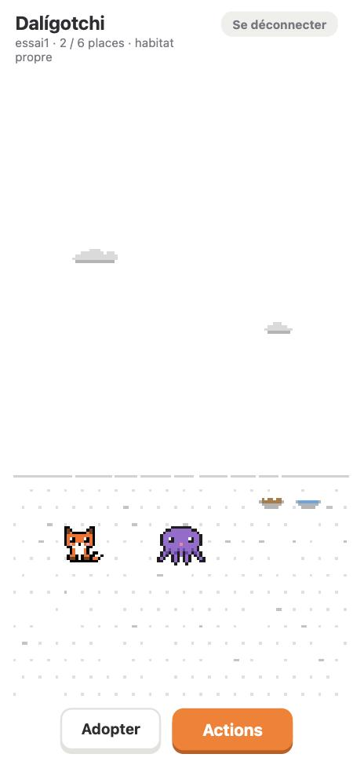

# Dalígotchi

**Un jeu d'animaux de compagnie en pixel art, imaginé et dessiné en famille.**

On adopte des œufs, on les couve jusqu'à l'éclosion, puis on prend soin d'animaux qui vivent leur vie : ils se promènent, dorment, réclament à manger ou à jouer. Au fil des générations, les rencontres entre animaux font naître des hybrides : un renard et un poulpe donnent… un poulpard.

<p align="center">
  
</p>

- **Environ quinze minutes par jour**, en deux visites, sans condition de victoire.
- **Bienveillant** : l'absence ne tue pas, les besoins sont décrits par des mots (« a faim », « se sent aimé »), jamais par des chiffres.
- **Sans publicité ni achat**.
- **En ligne** : [daligotchi.charlescoiffier.fr](https://daligotchi.charlescoiffier.fr) (version de test, sur invitation, le temps y passe 24 fois plus vite).

## Qui fait quoi

Les enfants imaginent les règles, dessinent les animaux dans [Piskel](https://www.piskelapp.com/) et testent le jeu ; les parents décident ; le code est écrit avec [Claude Code](https://claude.com/claude-code).

Les règles du jeu sont décrites dans le [Game Design Document](outputs/Daligotchi-GDD-v0.3.md), l'architecture dans le [plan technique](outputs/Daligotchi-Plan-technique-PVJ-v0.3.md).

## Avancement de la première version jouable

| Étape | Contenu | État |
|---|---|---|
| 0 | Fondations : monorepo, serveur, base de données, tests | ✅ |
| 1 | Règles de base : besoins, cycle de vie, génétique, simulateur | ✅ |
| 2 | Comptes et foyer | ✅ |
| 3 | Soins, décor, comportements des animaux | ✅ |
| 4 | Œufs, incubation, éclosion, lieu d'adoption | ✅ |
| 5 | Mise en ligne de test | ✅ |
| 6 | Relations : amour, pontes, nid, généalogie | ✅ |
| 7 | Rencontres entre joueurs | ✅ |
| 8 | Fin de vie | ✅ |
| 9 | Finitions : application installable, musiques et sons | |

## Dessiner pour le jeu

- **Animaux** : planches PNG exportées de Piskel dans `packages/client/public/sprites/` (sources `.piskel` dans `piskel/`). Une planche `poulpe_jeune.png` remplace automatiquement le dessin provisoire du poulpe.
- **Petits éléments** (cœur, balle, bulles, nuages, gamelles, œuf…) : dessinés **en lettres** dans [`pixelArt.ts`](packages/client/src/game/pixelArt.ts), chaque lettre étant une couleur. On peut les modifier case par case ; un test vérifie qu'aucun dessin n'est cassé.
- **Textes** : tous dans [`fr.json`](packages/core/src/i18n/fr.json).
- **Équilibrage** (vitesse de la faim, durée de l'incubation…) : tous les nombres sont dans [`balance.ts`](packages/core/src/balance.ts).

## Technologies

TypeScript partout, dans un monorepo pnpm : règles partagées (`core`), serveur **Fastify** + **PostgreSQL** (Drizzle), jeu **Phaser** (habitat) + **Preact** (menus), construit avec **Vite**. Déploiement par GitHub Actions sur un VPS, derrière Traefik.

Le serveur a toujours le dernier mot ; l'état des animaux est calculé « paresseusement » à partir d'un instantané et de l'heure, sans tâche qui tourne en permanence.

## Organisation

| Dossier | Contenu |
|---|---|
| `packages/core` | Règles du jeu partagées (besoins, cycle de vie, génétique, textes, simulateur), sans réseau ni base |
| `packages/server` | API Fastify + PostgreSQL (Drizzle) |
| `packages/client` | Jeu web : Phaser (habitat) + Preact (menus) |
| `deploy` | Déploiement sur le VPS (Docker Compose, Traefik) |
| `docs` | Images du README |
| `outputs` | GDD et plan technique, une version par fichier |
| `piskel` | Sources des dessins (Piskel) |
| `scripts` | Outils locaux (Postgres du projet) |

## Prérequis

- Node.js 24 (ou plus récent) et pnpm, activé avec `corepack enable pnpm`
- Les outils PostgreSQL 17 (`brew install postgresql@17`)

## Démarrer en local

```bash
pnpm install
```

```bash
cp .env.example .env
```

```bash
pnpm db:init
```

```bash
pnpm db:migrate
```

```bash
pnpm db:seed
```

```bash
pnpm dev
```

Le jeu s'ouvre sur http://localhost:5173 et l'API répond sur http://localhost:3000/api/health.

`pnpm db:seed` crée trois comptes de test (`essai1`, `essai2`, `essai3`), chacun avec un renard d'un âge différent. Leurs mots de passe sont écrits dans `.data/comptes-de-test.txt`, qui reste sur l'ordinateur et n'est jamais envoyé dans Git.

`pnpm db:init` crée un Postgres propre au projet dans `.data/` (port 5434, accessible uniquement en local). Après un redémarrage du Mac, il suffit de lancer `pnpm db:start`.

## Jouer depuis les téléphones de la maison

Sur le Mac, à la place de `pnpm dev` :

```bash
pnpm dev:wifi
```

Le terminal affiche une ligne `Network: http://192.168.x.x:5173/` : c'est l'adresse à ouvrir dans le navigateur des téléphones et tablettes **connectés au même Wi-Fi**.

- La première fois, macOS peut demander d'autoriser les connexions entrantes pour « node » : répondre **Autoriser**.
- Le Mac doit rester allumé et éveillé pendant la partie.
- L'adresse peut changer d'un jour à l'autre (elle est attribuée par la box) : se fier à la ligne `Network:`.
- Sur le téléphone, « Ajouter à l'écran d'accueil » donne un raccourci vers le jeu.
- `pnpm dev` (sans `:wifi`) garde le jeu accessible depuis le Mac seulement.

## Commandes utiles

| Commande | Rôle |
|---|---|
| `pnpm dev:wifi` | Lance le jeu pour les appareils du Wi-Fi de la maison |
| `pnpm test` | Tous les tests (core, serveur, client) |
| `pnpm typecheck` | Vérification des types |
| `pnpm simulate` | Fait vivre un animal toute sa vie en une seconde (options : `--visites 0\|1\|2`, `--jours`, `--absence 40:10`, `--longevite 1.1`, `--detail`) |
| `pnpm build` | Compile le jeu et le serveur |
| `pnpm db:generate` | Crée une migration après une modification de `packages/server/src/db/schema.ts` |
| `pnpm db:migrate` | Applique les migrations |
| `pnpm db:stop` | Arrête le Postgres du projet |
| `pnpm db:seed` | Crée les 3 comptes de test (refusé en production) |
| `pnpm admin create-user <pseudo>` | Crée un joueur et son foyer ; affiche un mot de passe généré |
| `pnpm admin reset-password <pseudo>` | Donne un nouveau mot de passe à un joueur |
| `pnpm admin list-users` | Liste les joueurs et leur dernière connexion |

## Réglages

- `WORLD_SPEED` dans `.env` : `1` correspond au temps réel, `24` à une journée de jeu par heure.
- Les nombres d'équilibrage sont dans `packages/core/src/balance.ts`.
- Les textes du jeu sont dans `packages/core/src/i18n/fr.json`.

## Déploiement

Chaque envoi sur la branche `main` construit l'image Docker sur GitHub Actions, la publie sur GitHub Container Registry, puis la déploie sur le VPS par SSH (modèle `vps-infra`, Traefik pour le HTTPS). L'application et sa base PostgreSQL tournent dans `~/srv/daligotchi/` ; les secrets (`DATABASE_URL`, `POSTGRES_PASSWORD`, `WORLD_SPEED`) sont dans `~/srv/daligotchi/.env` sur le VPS, jamais dans Git. Les migrations s'appliquent au démarrage du conteneur.

Créer les comptes des joueurs depuis le VPS :

```bash
ssh deploy@187.7.73.201 "cd ~/srv/daligotchi && docker compose exec app node dist/admin.js create-user <pseudo>"
```
